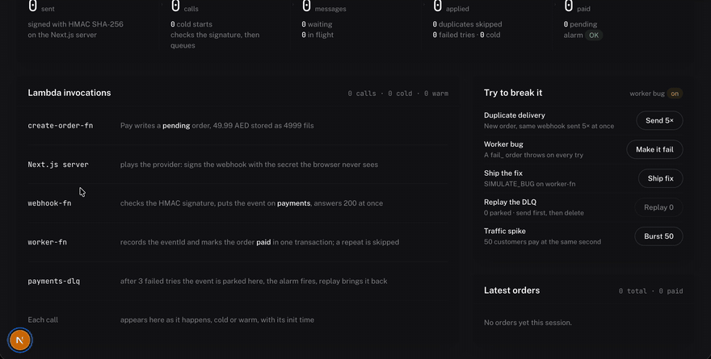
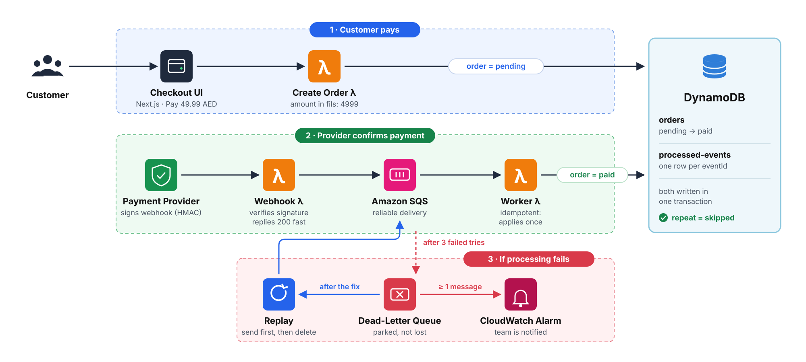

# Lambda launch-ready

Making a TypeScript AWS Lambda payments platform ready for launch: cold starts, idempotent webhooks, a dead-letter queue with alarm and replay, and a live checkout console. Everything runs on **LocalStack**, so it costs nothing to run.

## Demo



[Watch the MP4](docs/demo.mp4) (32 s). The first Pay starts every function cold (init 61–99 ms). The second Pay reuses the warm environments, so there's no init at all.

## How a payment travels



- **Idempotent worker:** the eventId and the order update are written in one DynamoDB transaction, so the same webhook sent 5× is applied once.
- **No lost payments:** after 3 failed tries a message is parked in `payments-dlq`, a CloudWatch alarm fires, and replay sends it back (send first, then delete).
- **The secret stays on the server:** only the Next.js server signs webhooks. The browser never sees `WEBHOOK_SECRET`.

## Projects

| Folder | What it does |
|---|---|
| `01-observability` | Structured logs (`coldStart`, `initMs`, `handlerMs`) and p50/p95/p99 reports |
| `02-lean-bundle` | esbuild, per-client SDK imports, lazy clients: before/after cold starts |
| `02-lean-package-py` | Python side track for SnapStart (Node.js has no SnapStart) |
| `03-webhook-reliability` | Signature check, SQS, idempotent worker, DLQ, alarm, replay, Function URLs |
| `checkout-ui` | Next.js 16 console that drives all of the above live |

## Run it

```bash
docker compose up -d                                    # LocalStack (needs LOCALSTACK_AUTH_TOKEN in .env)
cd 03-webhook-reliability && npm install && npm run deploy
cd ../checkout-ui && npm install && npm run dev          # http://localhost:3000
```

## What LocalStack can't show

Timings come from Docker containers on a laptop, not AWS Firecracker microVMs: use them for before/after, not as AWS latency. LocalStack doesn't model Lambda memory/CPU, so memory tuning and provisioned concurrency are covered as cost trade-offs, not measured. Function URLs run in `eu-central-1` locally because LocalStack doesn't route `me-*` regions; on AWS this would be `me-central-1`.

Progress, decisions and lessons: [PROGRESS.md](PROGRESS.md).
